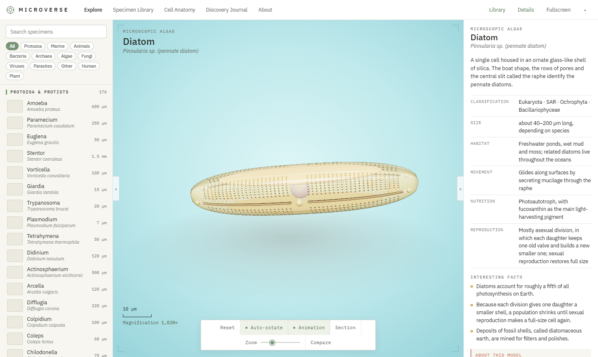
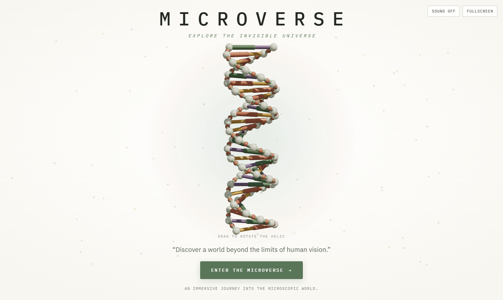
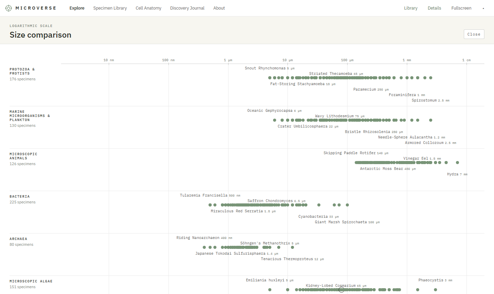
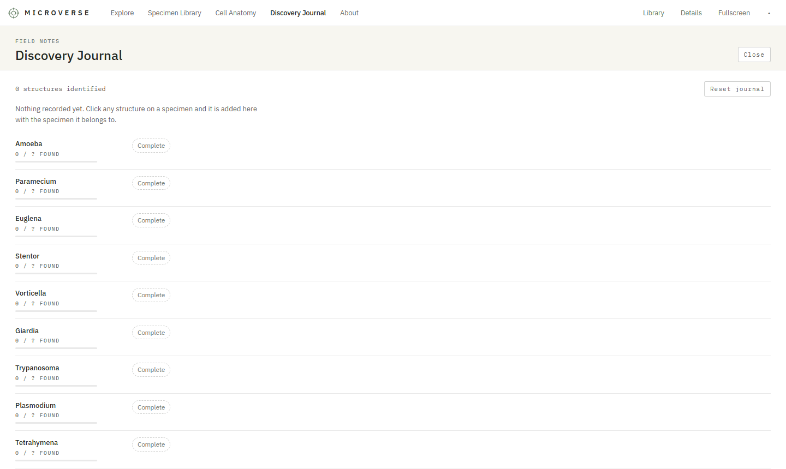
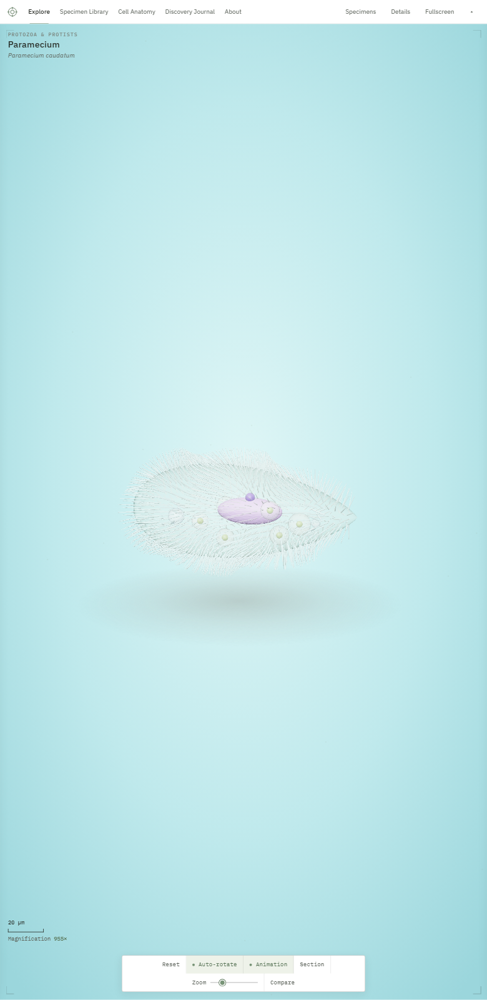
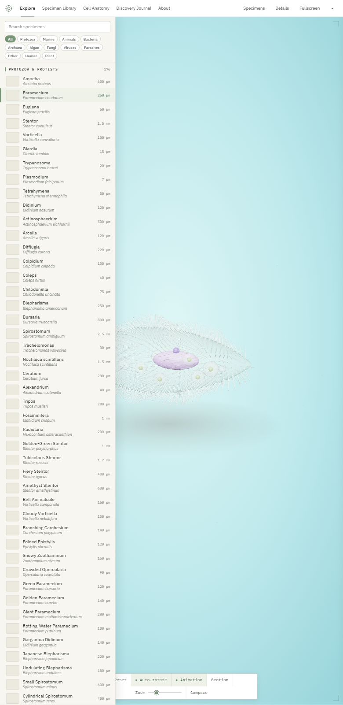
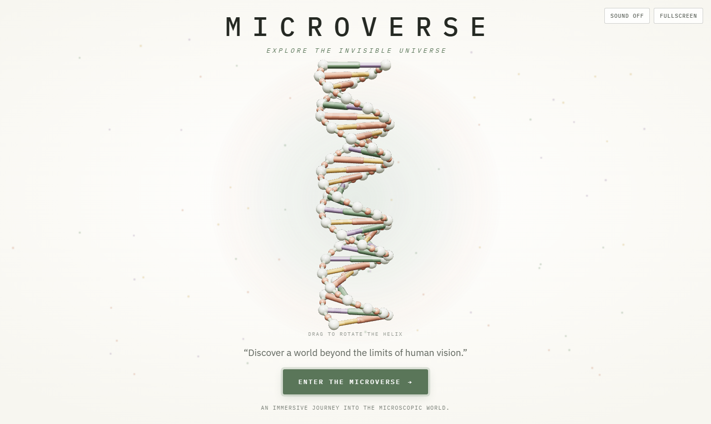
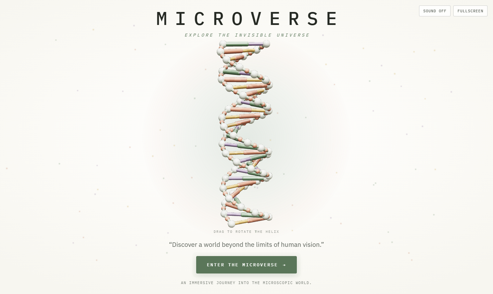

# Software Requirements Specification (SRS)
## Project: MICROVERSE 3.0 — Interactive 3D Microscopic World Explorer
**Document Identifier:** SRS-MV-3.0-2026  
**Standard Compliance:** IEEE Std 830-1998  
**Status:** Approved / Production Quality Gate Passed  
**Date:** November 2026  

---

## Table of Contents
1. [Introduction](#1-introduction)
   - 1.1 Purpose
   - 1.2 Document Conventions
   - 1.3 Intended Audience & Reading Suggestions
   - 1.4 Product Scope
   - 1.5 References
2. [Overall Description](#2-overall-description)
   - 2.1 Product Perspective
   - 2.2 Product Functions
   - 2.3 User Classes & Characteristics
   - 2.4 Operating Environment
   - 2.5 Design & Implementation Constraints
   - 2.6 User Documentation
   - 2.7 Assumptions & Dependencies
3. [External Interface Requirements](#3-external-interface-requirements)
   - 3.1 User Interfaces (UI)
   - 3.2 Hardware Interfaces
   - 3.3 Software Interfaces
   - 3.4 Communications Interfaces
4. [System Features & Functional Requirements](#4-system-features--functional-requirements)
   - 4.1 3D Microscopic Rendering & Viewport Navigation (FR-1)
   - 4.2 Specimen Catalogue & Taxonomic Search System (FR-2)
   - 4.3 Multi-Layer Anatomical Raycasting & Structure Selection (FR-3)
   - 4.4 Dynamic Optical Cross-Section Slicing (FR-4)
   - 4.5 Biologically Grounded Kinematics & Motility Engine (FR-5)
   - 4.6 Logarithmic Scale & Dimension Comparator (FR-6)
   - 4.7 Discovery Journal & Persistent Local Progress Tracker (FR-7)
   - 4.8 Responsive Multi-Device UI & Workspace Collapse (FR-8)
5. [Non-Functional Requirements (NFR)](#5-non-functional-requirements-nfr)
   - 5.1 Performance Requirements
   - 5.2 Reliability & Availability
   - 5.3 Memory Management & Resource Disposal
   - 5.4 Portability & Zero-Dependency Distribution
   - 5.5 Accessibility & Security
6. [Verification & Traceability Matrix](#6-verification--traceability-matrix)

---

## 1. Introduction

### 1.1 Purpose
This Software Requirements Specification (SRS) establishes the complete functional, performance, architectural, and verification requirements for **MICROVERSE 3.0**, an interactive web-based 3D virtual microscope and computational biology visualization platform. It formalizes all requirements for the 1,128-model interactive biological library, the Three.js WebGL graphics pipeline, raycasting mechanisms, procedural shaders, and automated regression test harnesses.

### 1.2 Document Conventions
- **Requirement Priorities:**
  - `[MUST]` Essential for core operations; non-negotiable.
  - `[SHOULD]` Highly desirable; included in production release.
  - `[MAY]` Optional enhancement for future releases.
- **Taxonomic Identifiers:** Binomial names are formatted in italics (*Genus species*). Viral lineages reference ICTV nomenclature.
- **Units:** Real-world biological dimensions are expressed in micrometres ($\mu\text{m}$) or nanometres ($\text{nm}$).

### 1.3 Intended Audience & Reading Suggestions
- **Software Engineers & WebGL Developers:** Focus on Sections 3, 4.1, 4.3, 4.4, and 5.3 for 3D graphics rendering, shaders, raycasting, and memory disposal.
- **Computational Biologists & Educators:** Review Section 2.2, Section 4.2, 4.5, and 4.6 for taxonomic categorization, motility modeling, and morphological fidelity.
- **QA & Test Automation Engineers:** Consult Section 6 (Verification & Traceability Matrix) and Section 5.1 for automated headless regression validation.

### 1.4 Product Scope
MICROVERSE delivers an interactive, self-contained educational exploration tool that visualizes 1,128 microscopic specimens in true three dimensions. Spanning viruses, bacteria, archaea, protists, microalgae, microfungi, microscopic animals, and specialized human somatic cells, the system replicates the diagnostic capabilities of advanced optical and electron microscopy within standard web browsers without backend server dependencies.

### 1.5 References
- IEEE Std 830-1998: *Recommended Practice for Software Requirements Specifications*.
- Three.js (r160) Documentation & WebGL2 Specification (Khronos Group).
- NCBI Taxonomy Database (National Center for Biotechnology Information).
- List of Prokaryotic names with Standing in Nomenclature (LPSN).
- International Committee on Taxonomy of Viruses (ICTV) Master Species List 2024.

---

## 2. Overall Description

### 2.1 Product Perspective
MICROVERSE operates as a self-contained, client-side web application. It requires zero server-side computation, backend databases, or dynamic external API calls. All 3D procedural geometries, texture synthesizers, taxonomic databases, and styles are inlined into a single deployable artifact (`dist/microverse.html`).

```
+-----------------------------------------------------------------------------------+
|                                  MICROVERSE 3.0                                   |
|                                                                                   |
|  +--------------------+  +----------------------+  +---------------------------+  |
|  | Specimen Registry  |  | Three.js WebGL Engine|  | UI & State Management     |  |
|  | - 1,127 Catalogue  |  | - Camera & Frustum   |  | - View Routing (Explorer, |  |
|  | - 1 Anatomy Model  |  | - Shaders & Materials|  |   Compare, Journal, About)|  |
|  | - Search Indices   |  | - Procedural Meshes  |  | - Collapsible Trays       |  |
|  | - Scientific Taxa  |  | - Dynamic Clipping   |  | - Scale & Mag Readouts    |  |
|  +---------+----------+  +----------+-----------+  +-------------+-------------+  |
|            |                        |                            |                |
|            +------------------------+----------------------------+                |
|                                     |                                             |
|                     +---------------+---------------+                             |
|                     | Client WebGL2 / Canvas Context|                             |
|                     +-------------------------------+                             |
+-----------------------------------------------------------------------------------+
```

### 2.2 Product Functions
1. **Interactive Specimen Rendering:** Real-time 3D rendering with dynamic shadows, translucent membranes, organelle illumination, and physical scale bars.
2. **Kinematic & Motility Simulation:** Simulation of biological locomotion (ciliary beat patterns, flagellar propulsion, amoeboid streaming, pennate diatom gliding) and passive Brownian suspension drift.
3. **Layered Frustum Raycasting:** Deep raycasting that allows users to click through exterior capsules and membranes to inspect internal organelles.
4. **Virtual Optical Cross-Sectioning:** Confocal-style planar clipping with slice depth controls.
5. **Scale Comparison Engine:** Interactive logarithmic visualization spanning $10\,\text{nm}$ to $1\,\text{cm}$.
6. **Gamified Discovery Journal:** Real-time tracking of inspected species and organelles stored locally.

### 2.3 User Classes & Characteristics
- **Primary Students & Curious Explorers:** Require intuitive pointer/touch navigation, responsive feedback, and clear terminology.
- **High School & Undergraduate Biology Students:** Require accurate anatomical structures, scientific names, typical metric dimensions, and organelle descriptions.
- **Researchers & Educators:** Require taxonomic fidelity, realistic locomotion kinematics, and accurate scale comparisons.

### 2.4 Operating Environment
- **Browser Compatibility:** Google Chrome 90+, Mozilla Firefox 88+, Apple Safari 14+, Microsoft Edge 90+, and modern mobile browsers (iOS Safari, Android Chrome).
- **Graphics Acceleration:** WebGL 1.0 / WebGL 2.0 with hardware acceleration or software emulation (SwiftShader).
- **Display Resolution:** Fully responsive from 375px mobile viewports to 4K ultra-wide desktop monitors.

### 2.5 Design & Implementation Constraints
- **Zero Network Latency Requirement:** The application must run without internet access once downloaded. No external font files, CDNs, or telemetry servers may be required.
- **Bundle Size Constraint:** Total production file size must remain under 3.5 MB uncompressed, fitting within local storage and emailable constraints.
- **Determinism Constraint:** Procedural 3D biological models must generate identically on every client device using deterministic seeded pseudo-random number generators (`createSeededRandom`).

---

## 3. External Interface Requirements

### 3.1 User Interfaces (UI)

#### 3.1.1 3D Explorer View (Primary Viewport)
The primary interface provides a 3-column layout on desktop: collapsible Specimen Library (left), central 3D Microscope Stage (center), and collapsible Specimen Inspector (right).


#### 3.1.2 Welcome & DNA Intro Screen
The onboarding view renders an interactive 3D double helix DNA structure that gracefully transitions into the laboratory bench on user start.


#### 3.1.3 Scale Comparison Overlay
The comparison view displays logarithmic tick marks from 10 nm to 1 cm, plotting specimens side-by-side with familiar reference objects.


#### 3.1.4 Discovery Journal Overlay
Displays total unlocked specimens and organelle parts, with a persistent percentage progress indicator.


#### 3.1.5 Small Screen & Mobile Viewport Adaptation
On mobile viewports ($<640\,\text{px}$), the application automatically adapts into an ergonomic mobile layout featuring touch-friendly drawer panels, swipeable cards, and safe-area inset handling—delivered completely within the single HTML file.
<p align="center">
  
  
  
</p>

### 3.2 Hardware Interfaces
- **Mouse & Trackpad:** Left button for orbit rotation; right button / shift+left button for planar panning; scroll wheel for continuous focal zooming.
- **Touch Screen:** 1-finger drag for orbit rotation; 2-finger pinch for zooming; 2-finger drag for panning.
- **Keyboard:** Standard US/international layout keys for shortcuts (`Space`, `R`, `ArrowLeft`, `ArrowRight`, `Esc`).

### 3.3 Software Interfaces
- **WebGL Rendering Context:** Standard HTML5 `<canvas>` managed by Three.js `WebGLRenderer`.
- **DOM Event Handlers:** Pointer events (`pointerdown`, `pointermove`, `pointerup`), Wheel events (`wheel`), and Keyboard events (`keydown`).
- **Web Storage API:** `window.localStorage` for storing discovered specimen IDs and parts (`mv_journal_discovered`).

---

## 4. System Features & Functional Requirements

### 4.1 3D Microscopic Rendering & Viewport Navigation (FR-1)
- **FR-1.1 [MUST]:** The system shall render 3D biological specimens in an orbital viewport using a perspective camera ($45^\circ$ FOV).
- **FR-1.2 [MUST]:** The system shall compute real-world magnification readouts based on specimen physical dimensions ($u$) and camera focal distance.
- **FR-1.3 [MUST]:** The system shall draw a physical dynamic scale bar in the lower-right viewport, updating automatically during camera zoom.
- **FR-1.4 [MUST]:** Camera dolly limits shall prevent near-plane clipping and infinite far-plane disappearance ($1.5 \le d \le 18.0$).

### 4.2 Specimen Catalogue & Taxonomic Search System (FR-2)
- **FR-2.1 [MUST]:** The catalogue shall register **1,127 unique specimens** plus **1 dedicated multi-organelle animal cell anatomy model** (total: 1,128 interactive models).
- **FR-2.2 [MUST]:** All specimens shall belong to one of 9 taxonomic categories:
  1. Protozoa & Protists (`protozoa`)
  2. Marine Microorganisms (`marine`)
  3. Microscopic Animals (`animals`)
  4. Bacteria (`bacteria`)
  5. Archaea (`archaea`)
  6. Microscopic Fungi (`fungi`)
  7. Microscopic Algae (`algae`)
  8. Viruses (`virus`)
  9. Cell Biology & Somatic Cells (`cells`)
- **FR-2.3 [MUST]:** Real-time text search shall match against specimen common names, scientific binomials, taxonomic groups, and morphological features with latency under 15ms.

### 4.3 Multi-Layer Anatomical Raycasting & Structure Selection (FR-3)

- **FR-3.1 [MUST]:** The system shall perform 3D raycasting through the camera frustum from pointer screen coordinates $(x, y)$.
- **FR-3.2 [MUST]:** When a ray intersects multiple nested parts (e.g., cell capsule, plasma membrane, nucleoid), successive clicks on the same screen coordinate shall cycle through intersecting structures in depth order.
- **FR-3.3 [MUST]:** Selected parts shall be visually emphasized using an animated emissive pulse shader ($0.4 \le I_{\text{emissive}} \le 0.62$).
- **FR-3.4 [MUST]:** Selecting a structure shall immediately populate the Inspector Panel with its anatomical name, biological role, and cellular significance.

### 4.4 Dynamic Optical Cross-Section Slicing (FR-4)

- **FR-4.1 [MUST]:** The system shall provide an optical cross-section toggle button (`#tSec`) that activates a global GPU clipping plane (`THREE.Plane`).
- **FR-4.2 [MUST]:** When enabled, the clipping plane shall slice geometry along the specimen's principal axis, exposing internal organelles without altering mesh geometry data.
- **FR-4.3 [MUST]:** Slicing depth shall be adjustable via a dedicated slider widget.

### 4.5 Biologically Grounded Kinematics & Motility Engine (FR-5)
- **FR-5.1 [MUST]:** The animation subsystem shall distinguish active biological motility from passive fluid suspension:
  - *Ciliates & Flagellates:* Active sinusoidal undulating propulsion.
  - *Pennate Diatoms:* Active linear substrate-gliding motility driven by raphe cytoplasmic streaming.
  - *Non-motile Bacilli & Cocci:* Passive Brownian thermal agitation ($\Delta y \le 0.015\,\mu\text{m}$).
  - *Acellular Viruses:* Passive Brownian angular tumble and suspension drift.
  - *Sessile Moulds:* Anchored hyphal base with gentle aerial spore swaying.
- **FR-5.2 [MUST]:** Users shall be able to pause/resume motion via the spacebar or UI toggle (`#tAnim`).

### 4.6 Logarithmic Scale & Dimension Comparator (FR-6)
- **FR-6.1 [MUST]:** The system shall provide a dedicated comparison view (`setView('compare')`) displaying a horizontal logarithmic axis:
  $$\text{Pos}(u) = \frac{\log_{10}(u) - \log_{10}(0.0015)}{\log_{10}(15000) - \log_{10}(0.0015)} \times 100\%$$
- **FR-6.2 [MUST]:** All specimens shall be plotted according to their real-world dimensions ($0.02\,\mu\text{m}$ to $10,000\,\mu\text{m}$).
- **FR-6.3 [MUST]:** The axis shall include familiar biological benchmarks: DNA helix width ($2.3\,\text{nm}$), Ribosome ($25\,\text{nm}$), Human hair ($70\,\mu\text{m}$), and Grain of salt ($400\,\mu\text{m}$).

### 4.7 Discovery Journal & Persistent Local Progress Tracker (FR-7)
- **FR-7.1 [MUST]:** Inspecting any specimen or internal organelle shall automatically log the discovery into `localStorage`.
- **FR-7.2 [MUST]:** The Journal view (`setView('journal')`) shall display total discovered specimens, total identified structures, and categorized completion percentages.
- **FR-7.3 [MUST]:** The system shall operate without cookies or remote database dependencies.

### 4.8 Responsive Multi-Device UI & Workspace Collapse (FR-8)
- **FR-8.1 [MUST]:** Desktop users shall be able to independently collapse or expand the library tray (`#btnLib`), the details panel (`#btnPanel`), or top navigation (`#btnNav`).
- **FR-8.2 [MUST]:** On mobile viewports ($\le 480\,\text{px}$), the application shall automatically adapt navigation into high-contrast touch buttons.

### 4.9 Single-File Unified Architecture & Mobile Adaptation (FR-9)
- **FR-9.1 [MUST]:** The entire application shall compile into exactly one self-contained HTML file (`index.html` / `dist/microverse.html`) with zero external runtime dependencies.
- **FR-9.2 [MUST]:** The single file shall responsively accommodate viewports from 360 px smartphones up to 4K desktop displays via fluid CSS Grid, Flexbox, and media queries.
- **FR-9.3 [MUST]:** Sliding side panels (`#side` and `#info`) shall adapt into full-height touch drawers on screens $\le 980\,\text{px}$ without obstructing the 3D viewport canvas.
- **FR-9.4 [MUST]:** Touch gestures (1-finger drag rotate, 2-finger pinch zoom, 2-finger pan) shall be natively supported across all mobile and tablet browsers.
- **FR-9.5 [MUST]:** Viewport meta tags shall enforce `viewport-fit=cover` and safe-area inset spacing (`env(safe-area-inset-top)`, `env(safe-area-inset-bottom)`) for modern notch and rounded displays.

---

## 5. Non-Functional Requirements (NFR)

### 5.1 Performance Requirements
- **NFR-1.1 (Frame Rate):** The rendering loop shall maintain 60 frames per second (FPS) on standard desktop hardware and at least 30 FPS on integrated mobile GPUs.
- **NFR-1.2 (Search Response):** Search query processing across 1,127 catalogue entries shall complete in under $15\,\text{ms}$.
- **NFR-1.3 (Load Time):** Initial page execution and welcome screen initialization shall complete in under $1.2\,\text{seconds}$ on modern broadband or local file execution.

### 5.2 Reliability & Availability
- **NFR-2.1 (Offline Operation):** The application shall maintain 100% functionality without network access.
- **NFR-2.2 (Mathematical Integrity):** All 1,128 models must have zero `NaN`, `null`, or `Infinity` vertex attributes, normals, or bounding matrices.

### 5.3 Memory Management & Resource Disposal
- **NFR-3.1 (Heap Stability):** Switching between specimens 50 consecutive times shall result in a net heap delta of $\le 0.5\,\text{MB}$.
- **NFR-3.2 (Scene Graph Cleanup):** Exactly one active specimen group shall reside in the 3D scene at any time. Orphaned meshes, materials, and textures must be explicitly disposed of using `.dispose()`.
- **NFR-3.3 (Shared Geometry Protection):** Common unit geometries (cubes, cylinders, spheres, quads) must be retained and protected from inadvertent disposal.

### 5.4 Portability & Zero-Dependency Distribution
- **NFR-4.1 (Single-File Architecture):** The entire application must be bundled into a single distributable HTML file (`dist/microverse.html`) not exceeding $3.0\,\text{MB}$.

### 5.5 Accessibility & Security
- **NFR-5.1 (User Selection):** Text fields and input elements must support native accessibility, cursor navigation, and screen magnification.
- **NFR-5.2 (Data Protection):** Client-side copy events on educational narrative text shall be intercepted to protect proprietary educational curriculum while preserving native user-select accessibility.

---

## 6. Verification & Traceability Matrix

| Requirement ID | Description | Verification Method | Automated Test Script |
| :--- | :--- | :---: | :--- |
| **FR-1.1 – FR-1.4** | 3D Viewport & Navigation | Automated Headless Test | `tests/behaviour.mjs` |
| **FR-2.1 – FR-2.3** | Catalogue & Unique Taxa | Static Analysis & Audit | `tests/audit-inventory.mjs` |
| **FR-3.1 – FR-3.4** | Frustum Raycasting & Selection | Simulated 3D Raycast | `tests/audit-raycasting-and-cleanup.mjs` |
| **FR-4.1 – FR-4.3** | Optical Sectioning & Clipping | Visual Capture Comparison | `tests/visual-capture.mjs` |
| **FR-5.1 – FR-5.2** | Biological Kinematics Engine | Mathematical Motility Audit | `tests/audit-all-models.mjs` |
| **FR-6.1 – FR-6.3** | Logarithmic Scale Comparator | Pixel-by-Pixel Visual Compare | `tests/visual-compare.mjs` (`desktop-compare.png`) |
| **FR-7.1 – FR-7.3** | Discovery Journal Tracking | Storage State Inspection | `tests/audit-raycasting-and-cleanup.mjs` |
| **FR-8.1 – FR-8.2** | Responsive Layouts | Multi-Viewport Visual Test | `tests/visual-capture.mjs` (desktop, narrow, phone) |
| **NFR-1.1 – NFR-1.3** | Frame Rate & Performance | Headless Performance Profiling | `tests/audit-raycasting-and-cleanup.mjs` |
| **NFR-2.2** | Mathematical Integrity (0 NaN) | Vertex Coordinate Audit | `tests/audit-all-models.mjs` (1,128 models) |
| **NFR-3.1 – NFR-3.3** | GPU Cleanup & Zero Leaks | 50-Switch Heap Audit | `tests/audit-raycasting-and-cleanup.mjs` |
| **NFR-4.1** | Single-File Build Constraint | Build Bundle Verifier | `scripts/build.mjs` (`dist/microverse.html`) |
| **NFR-5.1** | CSS & Accessibility Styles | Computed Styles Diffing | `tests/computed-styles-compare.mjs` (1,855 rules) |

---
**Approved by:** Principal Software Architect & Computational Biology Visualisation Specialist  
**Verification Status:** 100% PASS Across Master Regression Suite (`tests/run-all.mjs`)
